# De Rocket al Maglev

**Atlas 3D interactivo de la evolución de la tracción ferroviaria, 1829–2018.** Once hitos modelados a escala 1:1, con piezas que se pueden aislar, cortar en sección y ver funcionar, explicados para ingenieros mecánicos y eléctricos.

### ▶ [Abrir el atlas](https://jemilianomr.github.io/de-rocket-al-maglev/)

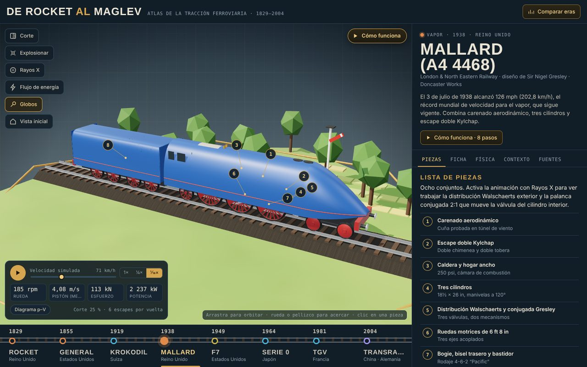

Funciona en cualquier navegador moderno con WebGL 2, en escritorio y en el teléfono. Se aprovecha la tarjeta gráfica y sólo se redibuja cuando algo cambia.

## Los once hitos

| Año | Tren | País | Tracción | Qué aporta |
|---|---|---|---|---|
| 1829 | Rocket | Reino Unido | Vapor | Caldera multitubular, hogar con camisa de agua y tiro por escape |
| 1855 | The General | Estados Unidos | Vapor | Bogie delantero y balancines compensadores para vías irregulares |
| 1879 | Siemens & Halske | Alemania | Eléctrica 150 V CC | Primer tren eléctrico alimentado desde una central fija: riel central, motor de 2,2 kW y engranajes cónicos con inversor |
| 1919 | Ce 6/8 II «Krokodil» | Suiza | Eléctrica 15 kV 16⅔ Hz | Transformador con 22 tomas, eje ciego y freno de recuperación |
| 1938 | Mallard (A4 4468) | Reino Unido | Vapor | Tres cilindros, Walschaerts + conjugada Gresley, escape Kylchap; récord de 203 km/h |
| 1941 | Union Pacific 4000 «Big Boy» | Estados Unidos | Vapor | 4-8-8-4 articulada de expansión simple: 602 kN y 540 t para subir el Wasatch sin refuerzo |
| 1949 | EMD F7 | Estados Unidos | Diésel-eléctrica | V16 de dos tiempos, generador de CC, motores suspendidos por la nariz, freno dinámico |
| 1964 | Shinkansen Serie 0 | Japón | Eléctrica 25 kV 60 Hz | Tracción distribuida, rectificador de silicio, señal en cabina (ATC) |
| 1981 | TGV Sud-Est | Francia | Eléctrica 25 kV / 1,5 kV | Tiristores, motores colgados de la caja, bogies Jacobs |
| 2004 | Transrapid de Shanghái | China / Alemania | Levitación magnética | Estator largo en la vía, sustentación EMS a ~10 mm |
| 2018 | Alstom Coradia iLint | Alemania / Francia | Hidrógeno | Pilas de combustible PEM, depósitos a 350 bar y batería sobre la plataforma Lint 54; sólo emite vapor de agua |

## Qué se puede hacer

**Cómo funciona.** Un recorrido de 8 pasos por tren (88 en total) que sigue la energía de la fuente a la rueda. La cámara, el corte, los rayos X, los flujos y la velocidad se ajustan en cada paso, y cada uno trae un dato o una ecuación con valores reales.

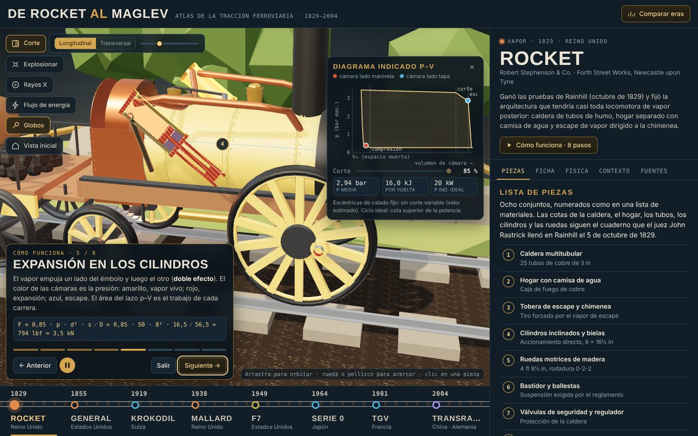

**Estudiar pieza.** Aísla la pieza sobre un plano con cuadrícula a escala y giro automático, señala sus componentes con letras (las etiquetas siguen a émbolos, crucetas, bielas y dados mientras se mueven) y dibuja cotas con valores de las fuentes. Las piezas vecinas que dan contexto quedan translúcidas.

| | |
|---|---|
| 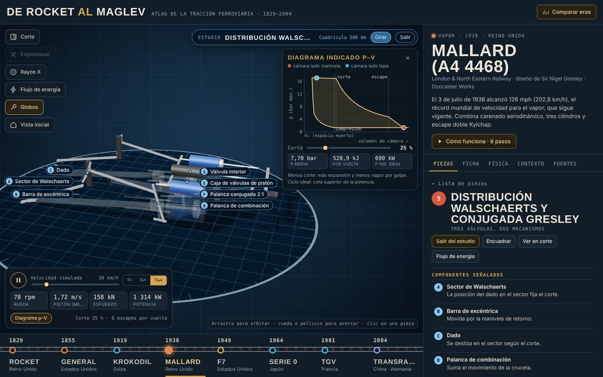 | 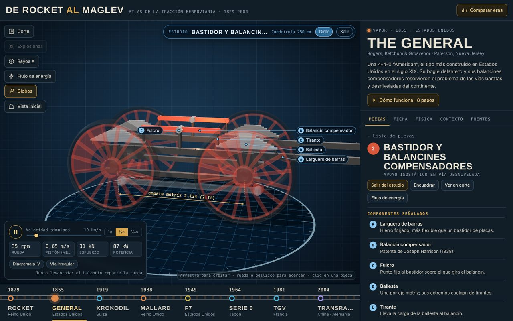 |
| 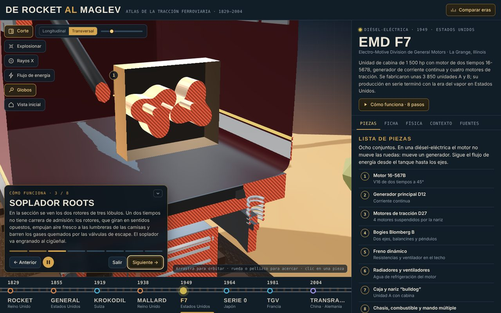 | 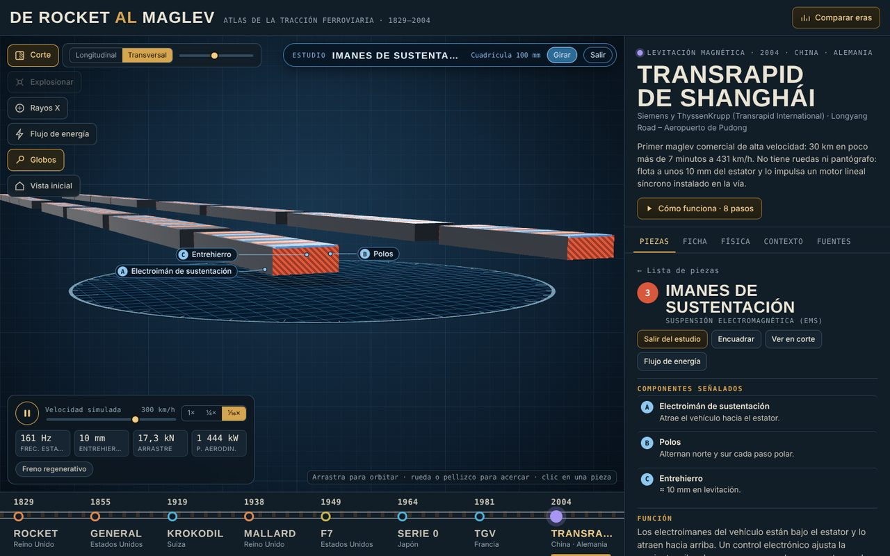 |

**Diagrama p–V en vivo** (locomotoras de vapor). Dos puntos recorren el lazo de cada cámara del cilindro, cuyo color indica la presión. Al mover el corte de admisión cambian la presión media efectiva, el trabajo por vuelta y la potencia indicada ideal.

**Además:**

- **Corte** longitudinal y transversal con superficies rayadas como en un plano.
- **Vista explosionada**, **rayos X** de carrocerías y **flujos de energía** animados (vapor, gases, combustible, corriente).
- **Modos:** freno regenerativo (flujo invertido en verde, hacia la red o hacia la batería) y reostático, vía irregular, curva cerrada de la articulada, régimen del diésel según el punto del acelerador y tomas del transformador.
- **Fichas técnicas**, curva esfuerzo–velocidad con límite de adherencia, **ecuaciones con datos reales**, **contexto histórico** (qué pasaba en la sociedad que explica el diseño) y **fuentes** por tren.
- **Comparar eras:** velocidad, potencia específica y carga por eje de los once trenes.

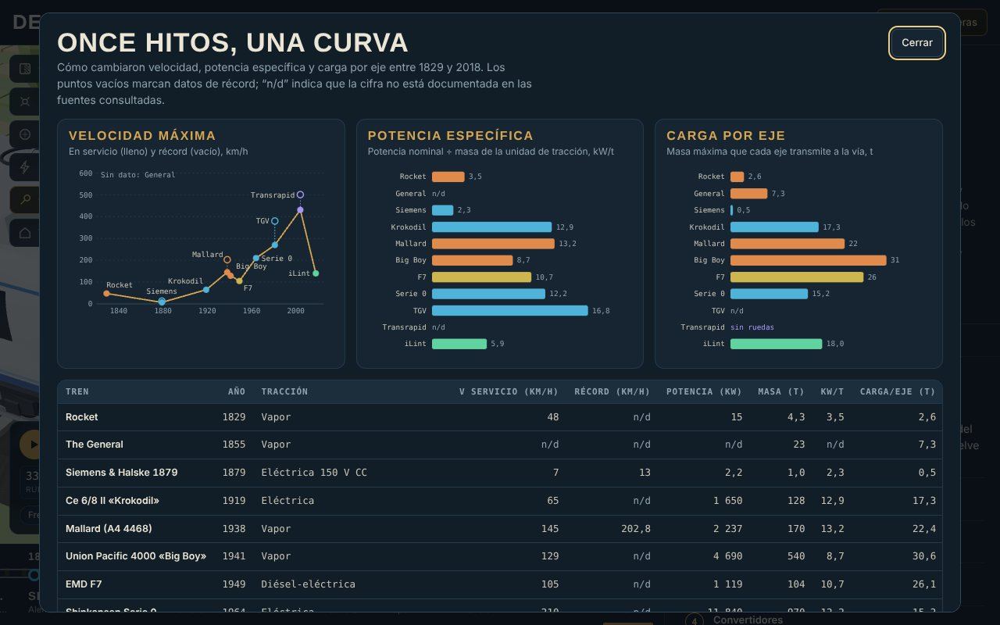

### Nuevos en la versión 3

| | |
|---|---|
| 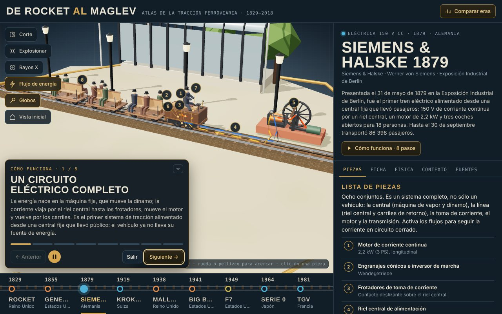 | 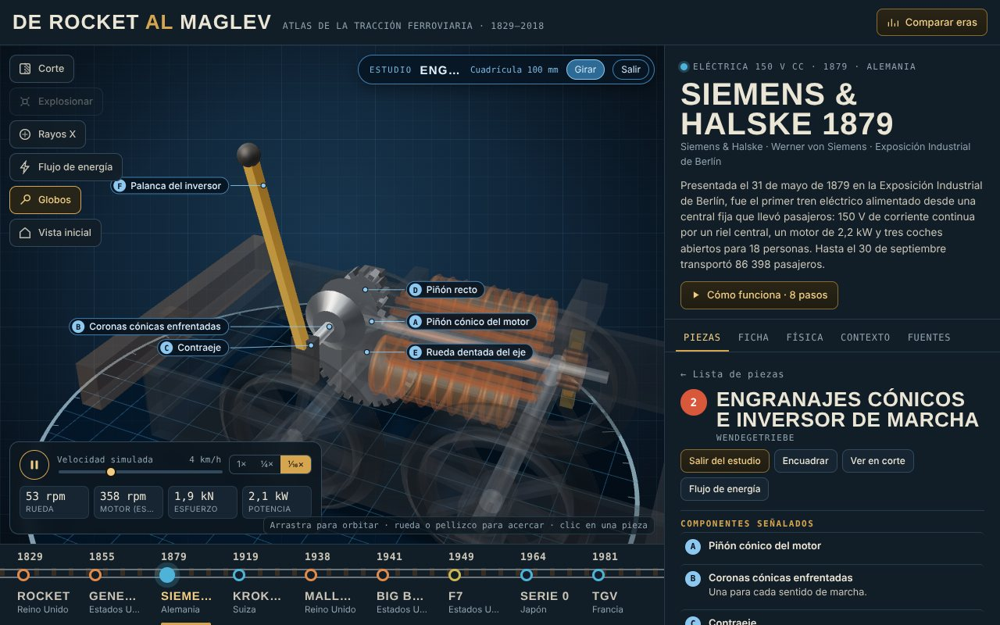 |
| 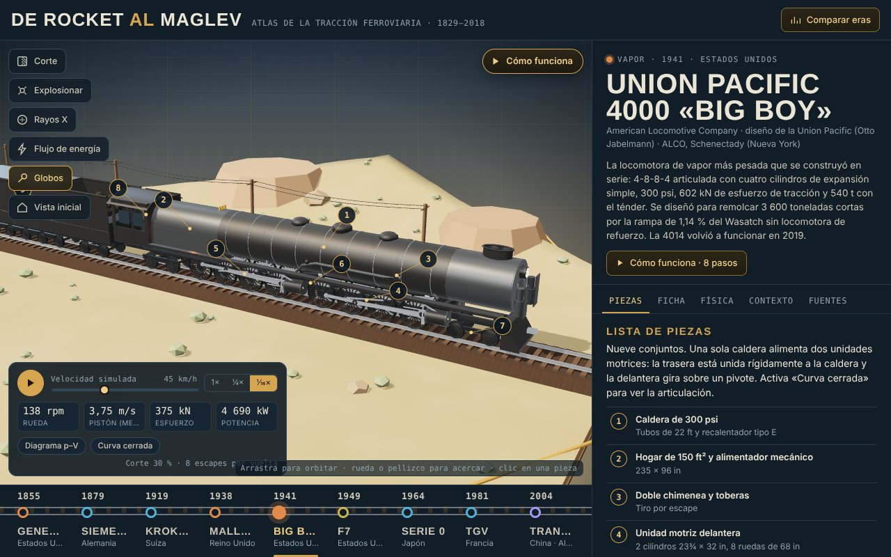 | 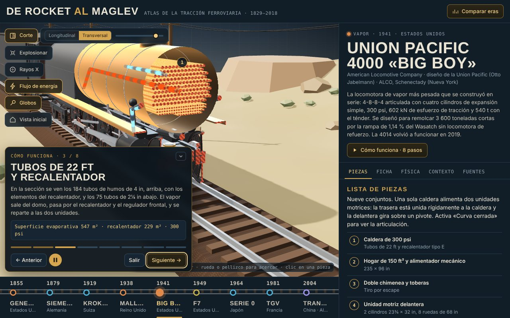 |
| 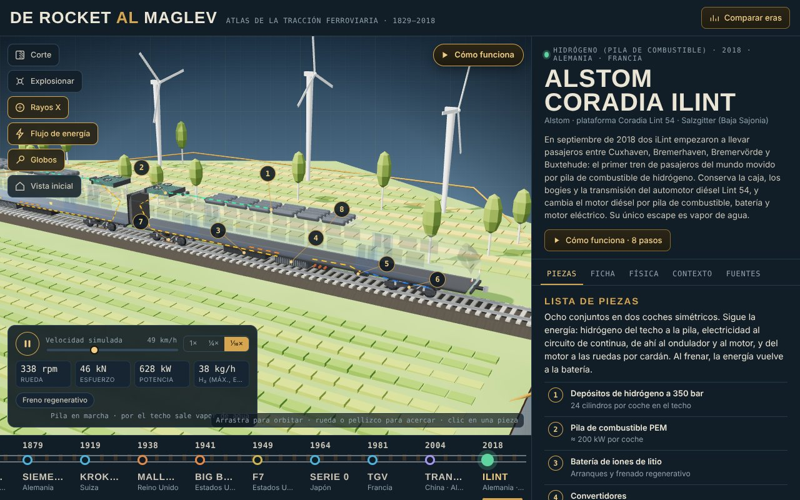 | 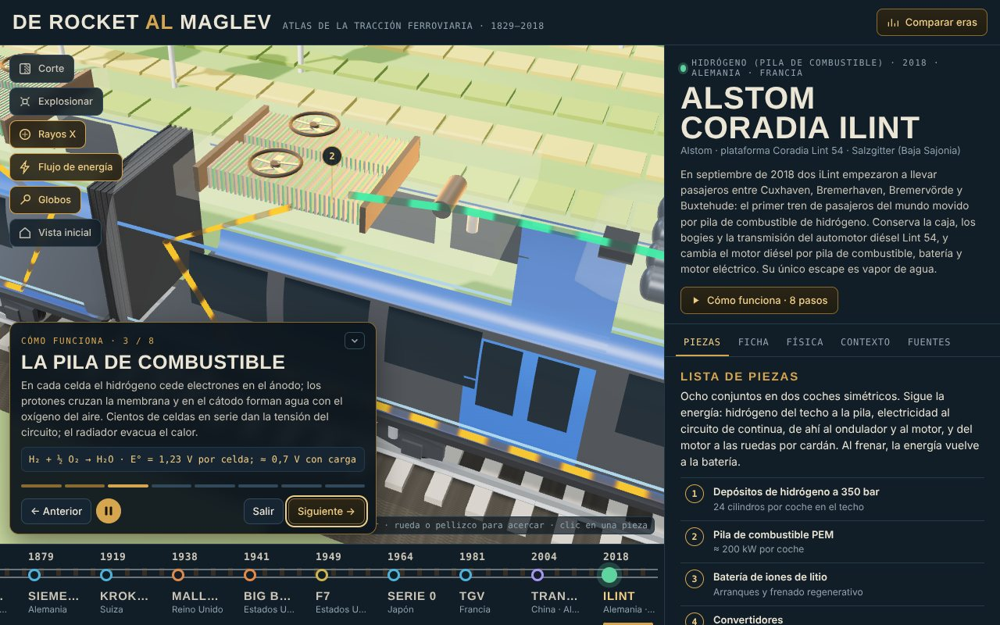 |

**Atajos de teclado:** ← → cambian de tren (o de paso en un recorrido) · <kbd>Espacio</kbd> animar · <kbd>C</kbd> corte · <kbd>E</kbd> explosionar · <kbd>X</kbd> rayos X · <kbd>F</kbd> flujos · <kbd>L</kbd> globos · <kbd>H</kbd> vista inicial · <kbd>Esc</kbd> salir.

## Exactitud y fuentes

Los modelos se construyen en código a escala 1:1 (1 unidad = 1 m) a partir de cotas publicadas: diámetros de rueda, empates, ancho de vía, cilindros, longitudes y posición de los componentes principales. Los detalles menores están simplificados y las cotas que no aparecen en las fuentes se estimaron por proporción; la pestaña **Fuentes** de cada tren indica cuáles, junto con las referencias primarias (por ejemplo, el cuaderno de J. U. Rastrick para Rocket o la especificación de Rogers para el General) y la bibliografía recomendada.

Dos supuestos están señalados en la propia interfaz:

- El diagrama p–V es un **ciclo ideal**: su potencia es una cota superior. A alta velocidad la presión en la caja de vapor cae y la potencia real es menor, como muestra la curva esfuerzo–velocidad.
- La presión de caldera del General (100 psi) es un **supuesto** típico de la década: la especificación de 1855 no la registra.

Otras estimaciones están indicadas en la ficha de cada tren; por ejemplo, la reducción de engranajes de la Siemens de 1879 (≈ 6,75), la longitud de la cámara de combustión y de la caja de humos de la Big Boy, o el consumo de hidrógeno del iLint en la telemetría (con un rendimiento de pila supuesto del 50 %).

## Estructura del repositorio

```
src/shell.html     interfaz: marcado y estilos
js/builders.js     primitivas, materiales con corte y realce, partículas en GPU, vía y diorama
js/models_base.js  clase Model, cinemática biela-manivela, simulación de vapor, frenos
js/stage.js        renderizador, luces, cámara y escenarios por era
js/m_*.js          un archivo por tren (geometría y animación)
js/data1.js–2.js   textos técnicos e históricos, fichas, ecuaciones y fuentes
js/data3.js        recorridos «Cómo funciona»
js/data4.js        modo estudio: componentes y cotas por pieza
js/data5.js        los tres trenes de la v3 (textos, recorridos y modo estudio)
js/app.js          interfaz: selección, corte, recorridos, estudio, p–V, paneles
build.py           compila todo en un solo HTML
docs/              sitio publicado en GitHub Pages (docs/index.html se genera)
test/              auditoría y pruebas con Playwright (ver test/README.md)
```

## Desarrollo

No hay dependencias de compilación: `build.py` concatena los módulos en un HTML autocontenido; three.js r147 se carga desde jsDelivr.

```sh
python3 build.py        # docs/index.html + dist/
```

Para probar en local abre `docs/index.html` en el navegador. Las pruebas automáticas están descritas en [`test/README.md`](test/README.md):

```sh
./tools/fetch_vendor.sh && python3 test/auditoria.py
```

## Historial

Los cambios de cada versión están en [`CHANGELOG.md`](CHANGELOG.md) y cada versión tiene su publicación en [*Releases*](https://github.com/Jemilianomr/de-rocket-al-maglev/releases) (`v1.0.0`, `v2.0.0`, `v3.0.0`), con un enlace para comparar una con otra. Las ideas y correcciones pendientes pueden registrarse en *Issues*.

## Licencia

Código bajo licencia [MIT](LICENSE). three.js es © sus autores, también bajo MIT. Los datos técnicos e históricos citan sus fuentes en la pestaña **Fuentes** de cada tren; las libreas son genéricas y no reproducen logotipos ni rotulaciones.
